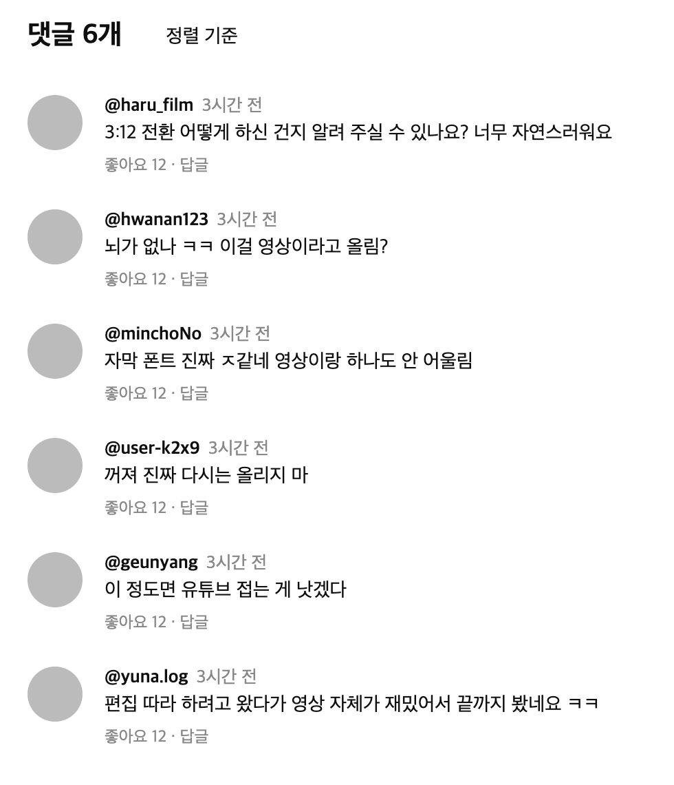
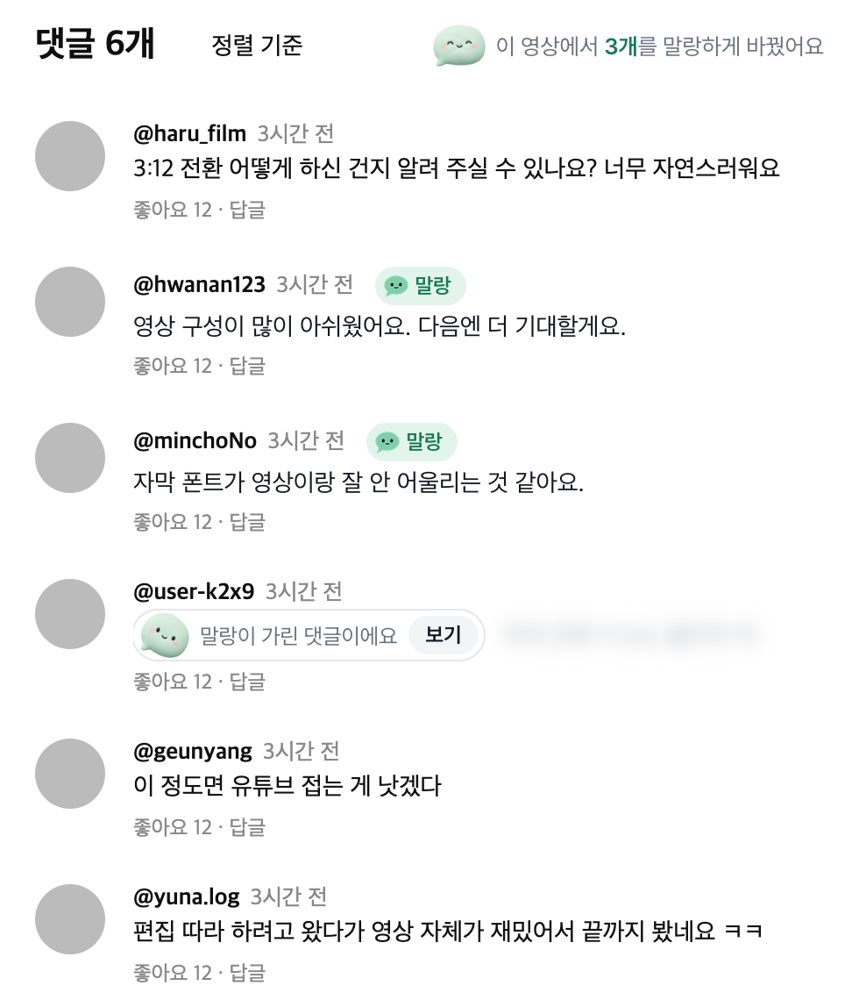
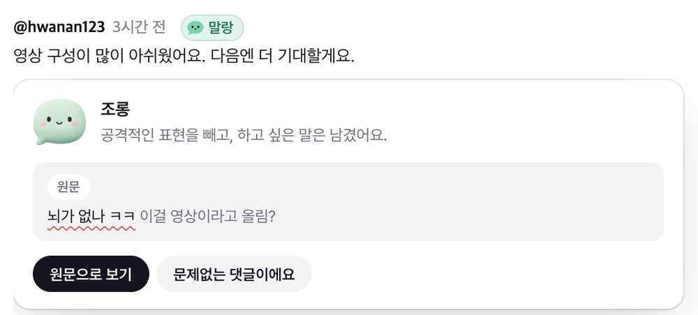
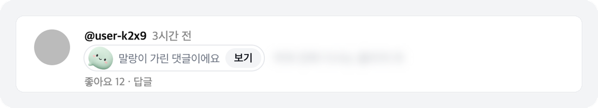
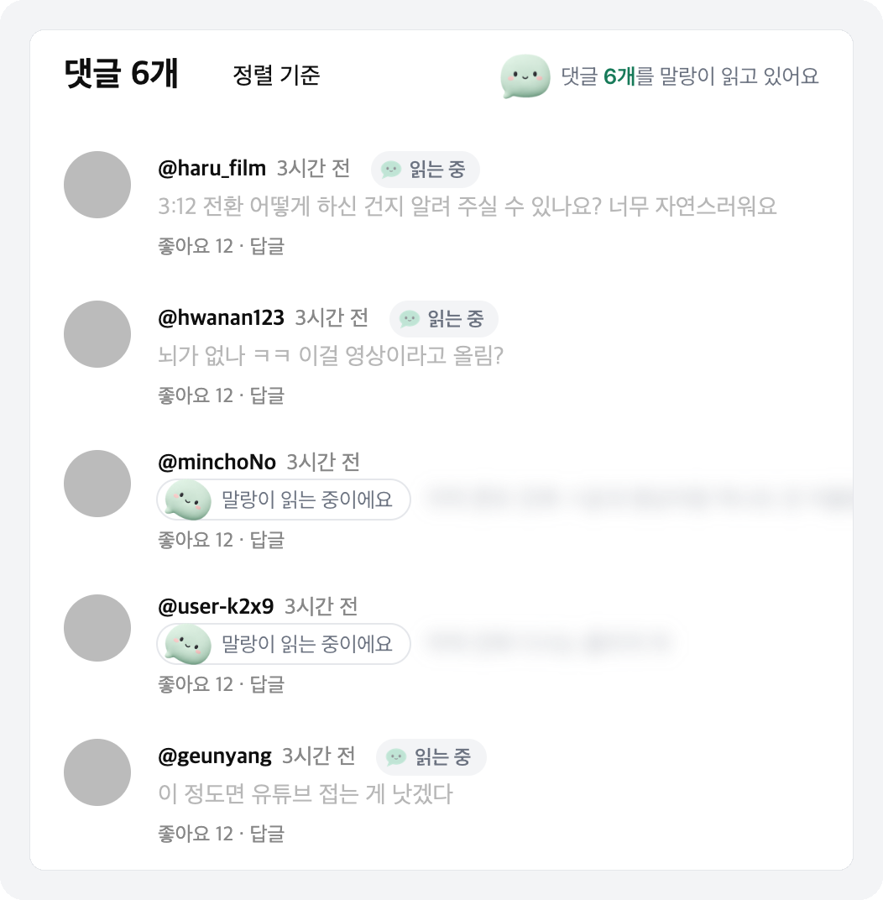
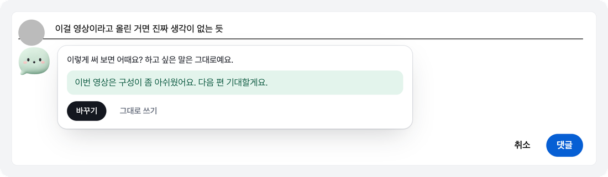
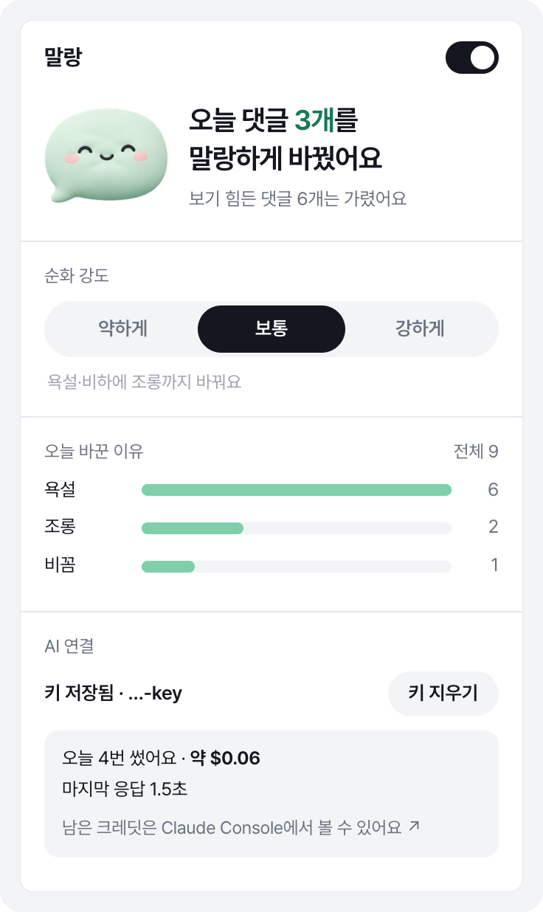
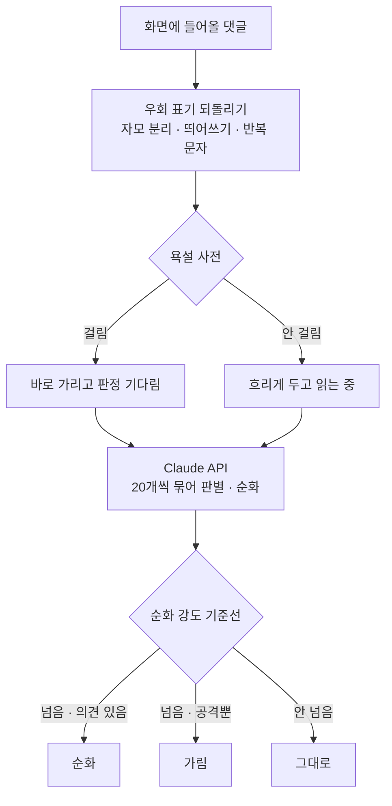

<div align="center">


# 말랑

**댓글의 의견은 남기고, 공격적인 표현만 걷어내요.**

유튜브 댓글을 말랑하게 바꿔 보여 주는 크롬 확장<br>
디지털새싹 문제해결 경진대회 2026 C.O.D.E. · 트랙3 상상 · 팀 말랑

</div>

<br>

| 원래 댓글 | 말랑을 켠 뒤 |
|:---:|:---:|
|  |  |

기존 필터는 욕설 댓글을 통째로 가려서 무슨 의견이었는지까지 사라져요.
말랑은 **"뇌가 없나 ㅋㅋ 이걸 영상이라고 올림?"** 을 **"영상 구성이 많이 아쉬웠어요. 다음엔 더 기대할게요."** 로 바꿔,
비판은 남기고 상처 주는 말만 걷어내요. 원문은 언제든 한 번 눌러 다시 볼 수 있어요.

<br>

## 말랑이 하는 일

<table>
<tr>
<td width="72" align="center"></td>
<td><b>순화하고, 이유를 보여 줘요</b><br>공격적인 댓글은 존중하는 한 문장으로 바꾸고, <code>말랑</code> 칩을 누르면 원문과 바꾼 이유가 나와요.</td>
</tr>
<tr>
<td align="center"></td>
<td><b>남길 의견이 없으면 가려요</b><br>"꺼져 진짜"처럼 공격뿐인 댓글은 억지로 바꾸지 않고 흐리게 가려요. <code>보기</code>를 누르면 펼쳐져요.</td>
</tr>
<tr>
<td align="center"></td>
<td><b>쓰기 전에 한 번 더</b><br>댓글을 쓰다 손을 멈추면 상처가 될 말인지 살펴보고 바꿔 쓸 문장을 제안해요. 전송은 절대 막지 않아요.</td>
</tr>
<tr>
<td align="center"></td>
<td><b>오늘 얼마나 말랑해졌는지</b><br>팝업에서 오늘 바꾼 댓글 수와 이유, 순화 강도(약하게·보통·강하게)를 확인하고 바꿀 수 있어요.</td>
</tr>
</table>

<br>

## 화면

### 순화한 댓글과 원문 카드

원문에서 문제가 된 표현에 물결 밑줄을 긋고, 어떤 유형(조롱·욕설·비하·외모 비하·혐오·비꼼·위협)이었는지 알려 줘요.
잘못 바꿨다면 **문제없는 댓글이에요** 를 누르면 그 댓글은 다시 건드리지 않아요.



### 가린 댓글



### 읽는 동안에도 알려 줘요

판정을 기다리는 댓글은 흐리게 두고 시간 옆에 **읽는 중** 을, 댓글창 머리에는 **"댓글 N개를 말랑이 읽고 있어요"** 를 보여 줘요.
AI 연결에 문제가 생기면 숨기지 않고 **"AI 연결에 문제가 있어 욕설만 가리고 있어요"** 로 알려요.



### 답글 코치



### 팝업

<table>
<tr>
<td width="340"></td>
<td>

- **순화 강도** — 기준선만 바꿔서, 바꿔도 AI를 다시 부르지 않아요.
  - 약하게: 욕설·혐오만
  - 보통: 욕설·비하에 조롱까지
  - 강하게: 비꼼과 공격적인 말투까지
- **오늘 바꾼 이유** — 유형별 막대
- **AI 연결** — Claude API 키, 오늘 사용 횟수와 어림 비용, 마지막 응답 시간이나 실패 이유

유튜브 다크 모드도 그대로 따라가요.

</td>
</tr>
</table>

<br>

## 설치

1. 이 레포를 내려받아요.
2. 크롬 주소창에 `chrome://extensions` → 오른쪽 위 **개발자 모드** 켜기
3. **압축해제된 확장 프로그램을 로드합니다** → 이 폴더 선택
4. 툴바의 말랑 아이콘 → **AI 연결** 에 Claude API 키(`sk-ant-api…`) 붙여 넣기

키가 없어도 욕설 사전으로 가리기는 바로 동작해요. 키를 넣으면 가리는 대신 말랑하게 바꿔요.
경진대회 시연용 키는 담당 선생님 명의로 만들어 써요.

> 확장을 새로고침(↻)했다면 열려 있던 유튜브 탭도 새로고침해야 새 버전이 붙어요.

<br>

## 어떻게 동작하나요



- **보이는 댓글만 읽어요.** 화면(오른쪽 패널이면 그 스크롤 상자) 한 장 앞까지만 미리 읽고, 안 본 댓글은 보내지 않아요.
- **사전은 즉시 가림과 안전망이에요.** 욕 없는 조롱("뇌가 없나 ㅋㅋ")은 사전으로 못 잡아서 AI가 맡고, AI가 실패하면 사전만으로 동작해요.
- **의미를 지켜요.** 순화문이 비었거나, 순화문에 욕이 남았거나, 원문보다 지나치게 길면 쓰지 않고 가려요.
- **같은 실패를 반복하지 않아요.** 키 오류·크레딧 부족이면 키를 바꿀 때까지 멈추고, 그 밖의 실패는 30초 쉬어요.

## 개인정보

- AI에 보내는 건 **댓글 본문뿐** 이에요. 작성자, 계정, 영상 정보는 보내지 않아요.
- 서버가 없어요. 확장이 Claude API를 직접 부르고, 키는 이 브라우저에만 저장돼요.
- 순화 결과는 저장하지 않아요. 남는 건 설정, 오늘 집계, "문제없어요" 목록(원문이 아닌 짧은 지문)뿐이에요.

<br>

## 폴더

| 경로 | 하는 일 |
|---|---|
| `src/content.js` · `content.css` | 댓글 감지, 판단, 그리기(칩·카드·가림·읽는 중·댓글창 머리) |
| `src/filter.js` | 우회 표기 정규화(초성·자모 분리·띄어쓰기·반복·전각)와 사전 대조 |
| `src/dict.js` | 욕설 사전 — 공개 데이터셋으로 키워 가요 |
| `src/background.js` | Claude API 호출(모델·프롬프트·응답 스키마), 사용량과 오류 기록 |
| `src/coach.js` | 답글 코치 |
| `popup/` | 켜기, 강도, 오늘 리포트, API 키 |
| `assets/` · `icons/` | 마스코트 네 포즈, 툴바 아이콘 |
| `design/` | 마스코트 원본과 화면 목업 |
| `test/` | 정규화 단위 테스트, 확장 e2e 테스트 |

AI 엔진은 `src/background.js` 의 `judge()` 한 곳에 모여 있어요. 기기 안에서 도는 로컬 모델로 바꿀 때도 이 함수만 갈아끼우면 돼요.
지금 모델은 `claude-opus-5-5` 이고, 더 빠르고 싸게 쓰려면 `MODEL` 을 `claude-haiku-5-5` 로 바꾸면 돼요.

## 테스트

```bash
node test/filter.test.mjs
```

```bash
PW_EXPERIMENTAL_SERVICE_WORKER_NETWORK_EVENTS=1 node test/e2e.cjs
```

e2e는 확장을 Chromium에 올리고 Claude 응답을 가짜로 바꿔 끼워, 키 없이도 순화·가림·강도·읽는 중·코치·팝업·AI 실패·실제 유튜브 화면까지 확인해요.
실제 유튜브 단계를 건너뛰려면 `SKIP_REAL=1` 을 붙여요.

<br>

## 앞으로

- 공개 댓글 200개로 오탐·미탐을 재고 사전과 프롬프트 보완
- 크롬 웹스토어 무료 배포, 코드 공개
- 외부 전송 없이 기기 안에서만 판별하는 "완전 로컬" 모드
- 인스타그램·치지직 등 청소년이 많이 쓰는 플랫폼으로 확장

## 팀 말랑

서울인공지능고등학교

| | 이름 | 맡은 일 |
|---|---|---|
| 팀장 | 박서준 | 확장 개발, 생성형 AI 연동, 결선 발표 |
| 팀원 | 백준오 | 화면 설계, 화면 요소 디자인, 사용자 테스트 |
| 팀원 | 서재호 | 욕설 데이터셋 수집·정리, 전처리 규칙, 순화 프롬프트 설계 |
| 담당교사 | 문서연 | 지도 |

<br>

<div align="center">

<br>
<sub>더 좋은 대화가, 더 따뜻한 세상을 만들어요.</sub>
</div>
